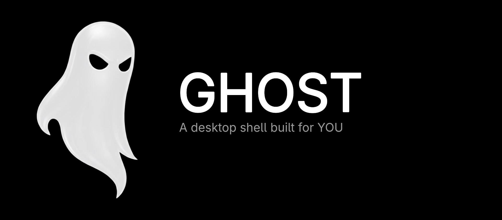

<div align="center">
  
</div>


## Installation

> [!IMPORTANT]
> **Migrating from v1:** All previous configuration will be backed up and unused. Configuration of compositor settings such as monitors, keybinds, and autostart is now up to you, as the project migrated from being dotfiles to being a shell.

### Arch Linux and its derivatives

For Arch-based distributions (including systemd, OpenRC, and other init systems), run the automated installation script.:

```bash
bash -c "$(curl -fsSL https://raw.githubusercontent.com/RichardtJustke/ghost/master/install/install.sh)"

```

> [!NOTE]
> To update, when or if you recieve a notification about the new version being available, just run the script again and choose "update"

---

### Compositor integration

> Sample configs, autostart entries, and keybindings for supported window managers and compositors are available in the [compositors](https://github.com/RichardtJustke/ghost/tree/master/compositors) directory.


#### Required autostart

Remember to add clipboard listeners and required services to your compositor's autostart configuration for the clipboard and the equalizer to work properly.

Example on Hyprland:

```lua
hl.on("hyprland.start", function()
  hl.exec_cmd("wl-paste --type text --watch cliphist store")
  hl.exec_cmd("wl-paste --type image --watch cliphist store")
  hl.exec_cmd("systemctl --user enable --now easyeffects")
end)

```
---

## Running

To run the shell, launch `ghostd start`

---


---

## License

Copyright (C) 2026 Illia Miroshnichenko

This project is licensed under the GNU Affero General Public License version 3, or (at your option) any later version. See the [LICENSE.md](LICENSE.md) file for the full license text.

